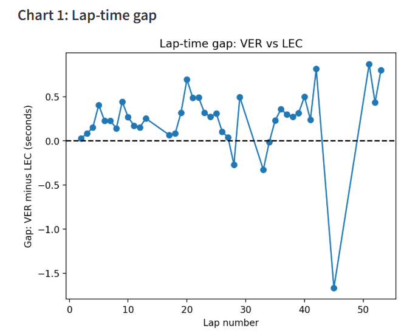
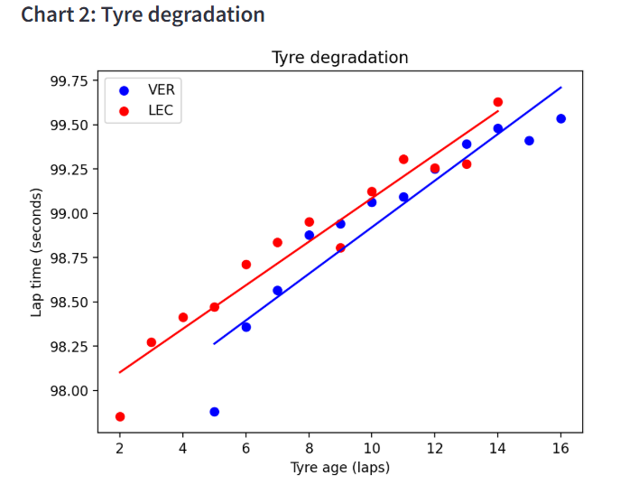
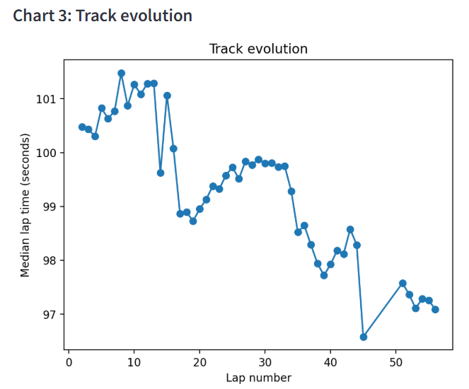

# F1 Race Dashboard

🔗 **Live app:** [f1-race-dashboard-mubarak.streamlit.app](https://f1-race-dashboard-mubarak.streamlit.app)

## Overview
A data analysis project using real Formula 1 race data to explore lap times, tyre degradation, and track evolution. An interactive dashboard was built with Streamlit, where you can select any race and any two drivers to generate all three charts on demand. This project consists of two datasets: Monaco 2022 and Bahrain 2022. Monaco is a poor dataset for analyzing tyre degradation due to the wet and intermediate compounds used; the goal of tyre degradation analysis was achieved using Bahrain 2022.

## Dataset Information
- **Source:** FastF1
- **Size:** Monaco 2022 — 1179 rows × 31 columns; Bahrain 2022 — 1125 rows × 31 columns
- **Format:** Lap-by-lap race data (via FastF1 API)
- **Key variables:** Driver, LapNumber, Compound, TyreLife, LapTime, LapTimeSec, Stint

## Workflow
1. **Data Cleaning:** There are missing values in PitOutTime, PitInTime (called NaT, "not a time") that help identify a racing moment. Rows with NaT LapTime were filtered out.
   - Monaco: 1179 → 910 → 844 → 566 → 566
   - Bahrain: 1125 → 958 → 858 → 858 → 858
2. **EDA:** Reviewed data types, checked descriptive statistics, and understood how the data values are spread out for each column.
3. **Feature Engineering:** Added LapTimeSec to convert the lap time into seconds.
4. **Dashboard:** Built three interactive charts in a Streamlit dashboard:
   1. Lap-time gap between two drivers
   2. Tyre degradation (how lap times change as tyres age)
   3. Track evolution (how the track gets faster over a race)

## Charts

## Files
- `FastF1.ipynb` — the full analysis notebook, step by step
- `dashboard.py` — the Streamlit dashboard app
- `lap_time_gap.png`, `Tyre_degradation.png`, `Track_evolution.png` — chart screenshots shown above

## Key Insight
Monaco 2022 started wet, which hid tyre degradation under the effect of the drying track. Bahrain 2022 was dry throughout, so tyre wear was clearly visible. This showed me how important it is to understand race conditions before drawing conclusions from lap time data.

## Tools Used
Python, Pandas, FastF1, NumPy, Matplotlib, Streamlit

## Author
**Name:** Mubarak Agboola

**Background:** Mechanical Engineering & Data Analytics
